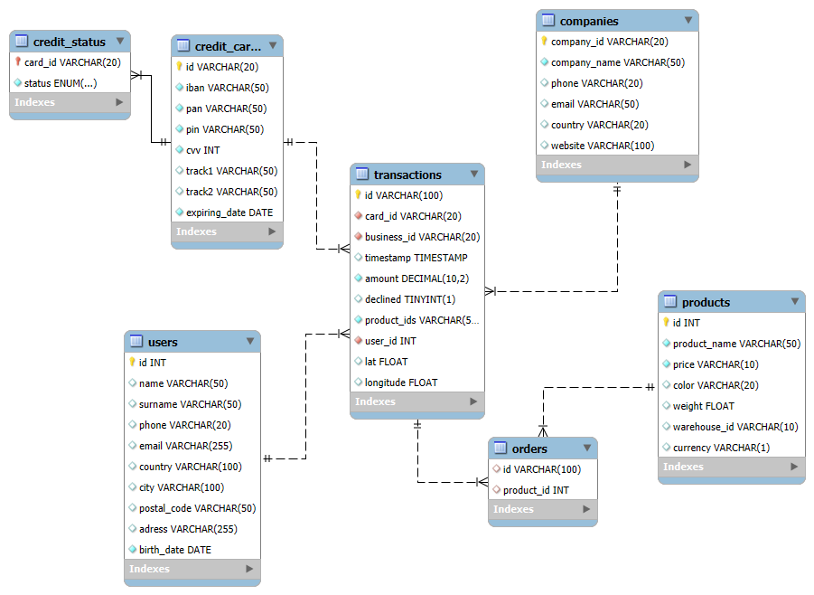

# Sales Database: Relational Model in MySQL

Design and implementation of a MySQL database for an online-sales company, built from raw CSV files (transactions, credit cards, users, companies, products). The project covers the whole data-engineering path: schema design, loading, cleaning, normalization of a multivalued field, foreign keys, and analytical queries.



## Data

Synthetic sales dataset provided during the Data Analytics bootcamp at IT Academy (Barcelona); it contains no real customers. Files: `transactions`, `credit_cards`, `companies`, `users` (three regional files: CA, UK, USA) and `products`.

## Design

Star schema: `transactions` is the fact table; `users`, `credit_cards`, `companies` and `products` are dimensions.

| Table | Role | Key |
|---|---|---|
| `transactions` | Fact: amount, timestamp, declined flag, location | `id` |
| `users` | Dimension: customer data | `id` |
| `credit_cards` | Dimension: card data | `id` |
| `companies` | Dimension: merchant | `company_id` |
| `products` | Dimension: product catalogue | `id` |
| `orders` | Bridge table: transaction ↔ product (N:M) | (`transaction_id`, `product_id`) |
| `credit_status` | Derived: card **active** / **blocked** | `card_id` |

### Design decisions

- **Multivalued field.** `transactions.product_ids` stored several ids in one cell (`"59, 71, 7"`), breaking first normal form. I split it into the bridge table `orders` with one row per (transaction, product) pair, joining with `FIND_IN_SET(products.id, REPLACE(product_ids, ' ', ''))`.
- **Card status.** A card is *blocked* if its last three transactions were all declined, otherwise *active*. Computed with the window function `DENSE_RANK()` over each card's timestamps (latest first), and stored in `credit_status`.
- **Type fixes.** `expiring_date` and `birth_date` arrive as text and are converted to `DATE`; the `$` is split from `products.price` into a numeric price.
- **Integrity.** Foreign keys from `transactions` to every dimension and from `orders` to `transactions` and `products`.

## Example queries (`sql/03_queries.sql`)

- Users with more than 30 transactions (subquery across two tables).
- Average amount per card IBAN for one company, with and without declined payments.
- Number of active cards.
- Number of times each product was sold, via the bridge table.

## Repository structure

```
├── sql/
│   ├── 01_schema.sql       # database and tables
│   ├── 02_load_clean.sql   # load CSVs, type fixes, foreign keys, orders, credit_status
│   └── 03_queries.sql      # analytical queries
├── data/                   # put the source CSV files here (not included)
└── docs/                   # EER diagram, report
```

## How to run

1. MySQL 8+ with `local_infile` enabled (`SET GLOBAL local_infile = 1;`) and the client started with `--local-infile=1`.
2. Run the scripts in order; paths in `LOAD DATA` are relative to where you launch the client from the repository root:

```bash
mysql --local-infile=1 -u <user> -p < sql/01_schema.sql
mysql --local-infile=1 -u <user> -p sales < sql/02_load_clean.sql
mysql -u <user> -p sales < sql/03_queries.sql
```

## Limitations

- Card numbers appear in the source files because the data is synthetic; a real system must never store full card numbers, CVV or PIN (PCI DSS) and should tokenize them.
- `credit_status` is a static snapshot; in production it would be a view or refreshed by a scheduled job.
- No indexes beyond keys; no query-performance work on a dataset this size.

## Author

**Nicola Korff** · [LinkedIn](https://www.linkedin.com/in/nicola-korff/)
